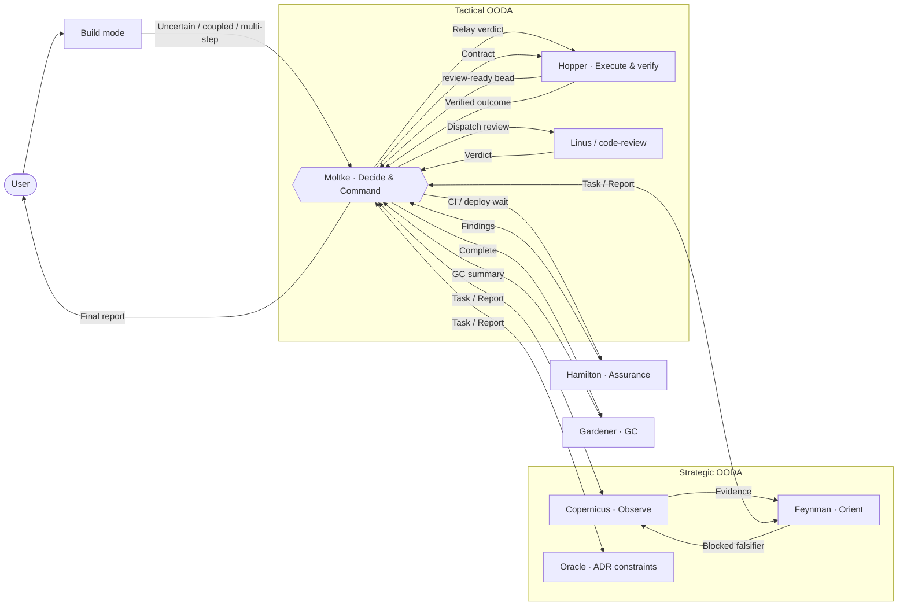

# OODA Loop Agents for OpenCode

Eight subagents orchestrated across two OODA loops (`Strategic` and `Tactical`), plus two primary prompt modes (`build` and `plan`). Agents focus on role, coordination, delegation boundaries, and skill loading; coding/toolchain mechanics live in skills.

## Agent Roster

| Role | Agent | Responsibility |
|---|---|---|
| Observe | `copernicus` | Pure sensor. Gathers cited facts (`path:line`, command exits, web/spec docs); registers large evidence in `bd` beads. No hypotheses, no edits. |
| Orient | `feynman` | Synthesizes observations into ≥ 2 ranked causal hypotheses with cheap falsifiers and a stress-test. Re-tasks `copernicus` on blocked falsifiers; consults `oracle` on architectural surfaces. |
| Specialist | `oracle` | Surfaces binding ADR constraints, tensions, and gaps via `adr-fmt` or markdown fallback. Informs, never decides. |
| Decide | `moltke` | Standing mission commander (Auftragstaktik). Sets `commander_intent`, authors TOML mission contracts/packages with pre-mortem and abort criteria, commands `hopper`/`linus`/`hamilton`, verifies results, and invokes `gardener`. |
| Act | `hopper` | Executes mission contracts via TDD (`red → green → refactor`), Tidy First commit separation, and tier-scoped verification (`inner`/`mid`/`boundary`). Returns `review-ready` beads and outcomes to `moltke`. |
| Review | `linus` | Pre-merge Rust-specialist code reviewer (source-level). Reviews idioms, type safety, `unsafe` soundness, resource contracts, and test design. Read-only on source; writes verdicts to `bd` beads. |
| Assurance | `hamilton` | Runs during CI/deploy wait windows on `main` (or external PRs). Reviews cross-component failure, ADR alignment, resource stress, recovery/shutdown, and broad regressions. Read-only; files `assurance-finding` beads for `moltke`. |
| Closeout | `gardener` | Closes completed `bd` mission epics and spent scaffolding, holds live findings, and runs guarded Cargo artifact and aged trace cleanup. |

## The Two OODA Loops



## Modes: `plan` vs `build`

- **Plan mode (`prompts/plan.md`)**: Read-only on the working tree. Uses `copernicus`, `feynman`, `oracle`, and `linus`/`code-review` to produce a structured written plan (goal, evidence, options, stakes, success criteria, risks, open questions). Never dispatches `moltke` or `hopper`.
- **Build mode (`prompts/build.md`)**: Completes bounded, low-risk, reversible work (and inspected, authorized Git operations) directly using skills. Delegates uncertain, coupled, or multi-step work — and plan-mode artefacts — to `moltke`, which drives execution end-to-end.

## Coordination Primitives

- **Beads (`bd`)**: Primary cross-agent memory layer. Contracts, evidence, review reports, and oracle summaries live in `bd` bead `description` fields; handoffs pass `artefact: bd-NNN`, never raw dumps or working-tree paths.
- **Frozen Handoff Line**: Every subagent reply ends with:
  ```text
  → to: <agent|user> | status: <ready|blocked|needs-reloop|complete> | next_input: <one-line> | artefact: <bd-NNN|->
  ```
- **Back-Briefs**: Subordinates append a structured `↑ back-brief to moltke` block (`Surprise | Opportunity`) after the handoff line when an observation materially alters `commander_intent` or mission bounds.
- **Skills (`skills/*/SKILL.md`)**: Own domain, toolchain, and workflow mechanics (`fleet-execution-methods`, `git-workflow-and-versioning`, `rust-design-evidence`, `code-review`, `diagnosing-bugs`, `adr-fmt`, `comment-free`, `graphify`, `beads`, `wayfinder`, `spec-driven-development`, `repo-closeout`, `repo-eval`, `quality-sweep`, `sf-sdlc-check`, `rust-dep-intake`, `create-verification-skill`, `grill-me`, `show-me`, `obsidian-second-brain`, `agent-browser`).

## Layout

```text
~/.config/opencode/
├── opencode.json        # Model bindings, permissions, plugins
├── AGENTS.md            # Shared fleet doctrine (auto-loaded)
├── README.md            # Overview (this file)
├── DB-MAINTENANCE.md    # Offline SQLite maintenance runbook
├── prompts/             # Mode prompts (build.md, plan.md)
├── agents/              # Subagent definitions (8 agents)
├── skills/              # Reusable toolchain & workflow skills
├── commands/            # Custom slash commands (/prime, /validate, /create-prd, /create-rules)
├── plugins/             # Runtime hooks (tracer.mjs, dramallama-guard.mjs)
└── maintenance/         # Offline opencode.db VACUUM script & launchd plist
```
